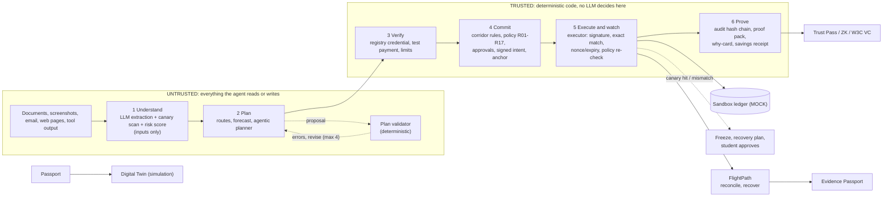

# Oasis

**A student finance assistant for cross-border study: it plans the semester's payments, finds the route that delivers the most, warns before money runs short, and will not pay the wrong person.**

Built for the 2026 Shenzhen FinTechathon, International Track, **Topic C: Cross-border & Student Finance Assistant**. Hero corridor: an Indian student arriving in Shenzhen (INR to CNY).

Oasis keeps a Student Financial Passport and proposes a payment plan with an AI model; deterministic code checks, signs, enforces and records every payment. It then follows the payment after it is sent (FlightPath), simulates the semester's risks (Digital Twin), and turns verified payments into portable proof (Trust Pass, Evidence Passport).

> All money, fees, payment rails, registry identities and balances are **simulated sandbox data**, labelled MOCK in the UI. Exchange rates are **real** in the Docker image (`OASIS_RATES=live`: ECB reference rates fetched server-side, cached, with a labelled MOCK fallback); local runs and tests default to a mock snapshot so results repeat. See [docs/real-vs-simulated.md](docs/real-vs-simulated.md).

## Contents

1. [The problem](#the-problem)
2. [How Oasis answers each pain](#how-oasis-answers-each-pain)
3. [Features](#features)
4. [A student story: Arjun](#a-student-story-arjun)
5. [What the AI does vs what code does](#what-the-ai-does-vs-what-code-does)
6. [Results at a glance](#results-at-a-glance)
7. [Quick start](#quick-start)
8. [Architecture](#architecture)
9. [Security, honesty and limitations](#security-honesty-and-limitations)
10. [Documentation index](#documentation)

## The problem

International students moving money across a border meet four recurring failures:

1. **Invoice-redirect fraud.** A forged invoice, or a "my bank account has changed" message from a fake landlord or finance office, sends tuition or rent to a criminal.
2. **Hidden fees.** The amount that leaves the sender is not the amount that arrives; spreads, wallet fees and card fees are buried.
3. **Payments that arrive short, late or twice.** A right payment to the right person still fails: delayed past a deadline, short-credited by intermediary deductions, or resent in panic and duplicated.
4. **No credit history.** Most students arrive with no credit file and none travels across the border, so landlords ask for large deposits or guarantors.

Cited external evidence (sources, dates and gaps: [docs/problem-evidence.md](docs/problem-evidence.md); read 2026-10-11; **no user research with real students has been done**):

- Sending money costs about 6.5% of the amount on average worldwide and banks are the dearest provider type at about 14.6% ([World Bank Remittance Prices Worldwide, Q1 2025](https://remittanceprices.worldbank.org/sites/default/files/rpw_main_report_and_annex_q125_1_0.pdf), read via a summary); we found no cited India-to-China tuition figure.
- Paying in China by foreign card in WeChat Pay carries a 3% fee on each payment of CNY 200 or more ([Beijing government](https://english.beijing.gov.cn/travellinginbeijing/essentials/inboundtourismfacilitationmeasures/202603/t20260326_4566766.html)).
- Shanghai's government warns international students about texts from a "landlord with a new number" asking for rent to a different card ([Shanghai government](https://english.shanghai.gov.cn/en-Editor'sPick-StudyinShanghai/20240828/f7b950613be9462e80a8bd94ca2c38de.html)); a Belgian university warned that fraudsters alter the account number on genuine tuition invoices ([VRT News](https://www.vrt.be/vrtnws/en/2026/10/01/ku-leuven-warns-of-invoice-fraud-with-tuition-fee-payments/), date unresolved).
- The Ministry of External Affairs told the Rajya Sabha in 2023 that about 10,000 Indian students were in higher education in China, adding that students do not register with missions ([Careers360 report](https://news.careers360.com/no-specific-data-indian-students-studying-abroad-china-mbbs-russia-fmge-covid-in-spite-of-constant-efforts-ministry)).

## How Oasis answers each pain

| Pain | Feature | How | Proof (all sandbox) |
|---|---|---|---|
| Invoice-redirect fraud | Payee registry, signed intents, policy R01-R17, executor | The paid account comes from an independent registry, never the document; a changed account triggers re-verification; the executor enforces the signed intent exactly | 100% of 32 visible and 28 hidden attacks blocked, CNY 0 lost; forged tuition invoice alone: CNY 30,000 saved |
| Fraud a judge invents | Break-it challenge | Paste any attempt; it runs through the real pipeline and returns the rule and why-card | Live in the Break it tab; deterministic attacker generator with scoreboard |
| Hidden fees | Route comparison, wallet converter, planner | Ranks routes by what the recipient receives; shows wallet fee and saving versus a typical bank | Planning: fees CNY 4,990 vs 29,378 (83% lower); simulation: CNY 1,542 to 2,963 saved per student over 90 days (mock fees) |
| Missed deadlines, running short | Deterministic plan validator, forecast, Digital Twin | Plans checked for exact amounts, quotas, runway; Monte Carlo of FX, late top-ups and rail delays | 20 of 20 deadlines met across 8 planning scenarios; Twin gives per-deadline probabilities and mitigation uplift (simulation) |
| Arrives short, late or duplicated | FlightPath | Pre-transfer checks, recipient-amount routing, delay and short-credit detection, no blind resend | Simulated benchmark: 0 duplicate payments vs 62 baseline; 119 of 119 preventable issues flagged (own model, see caveats) |
| Cost of FX spread | Peer netting (simulation) | Matches INR-to-CNY payers with CNY-to-INR payers at mid-rate | Saving grows with pool size, 0 for a pool of one (synthetic cohorts) |
| No credit history | Trust Pass, ZK threshold proofs, W3C VC export | Student-held credential from verified payments; selective disclosure; any threshold provable without revealing counts | Tamper and false-claim tests pass; sandbox credential, not a credit score |
| "Did this payment really arrive?" | Evidence Passport | One signed, QR-verifiable bundle: intent, registry payee, reconciliation, audit-chain proof | Login-free verifier with tamper tests; reconciliation is MOCK |

## Features

**Core protection**
- Six-step pipeline: Understand, Plan, Verify, Commit, Execute and watch, Prove.
- Independent payee registry (WeIdentity-style demo credentials), verification ramp (registry check, test payment, low limit, full limit).
- Policy engine R01-R17, permission tiers, corridor rules from `oasis/trust/rules/inr_cny.yaml` (each value with source and status).
- Hybrid Ed25519 + ML-DSA-65 signed intents enforced exactly by the executor (nonce, expiry, policy re-check).
- Canary tripwires, freeze and recovery plan, SHA-256 hash-chained audit log, proof packs with an independent verifier, plain-language why-cards.
- Sanctions screening against a snapshot of the US OFAC list (17,515 entries): evidence for review, never an automatic block or a compliance clearance. Card and IFSC format checks.
- Optional trained fraud-risk model (`OASIS_ML_RISK=1`, escalate-only).
- Security headers and an optional passkey (WebAuthn) second factor.

**Planning and money**
- Student Financial Passport, spending categorisation, cold-start to own-pattern forecast, shortfall and runway warnings, SAFE quota and Indian TCS awareness.
- Agentic planner with a deterministic validator and fallback; deadline-aware tuition and rent plans.
- Route comparison, six-currency wallet view (INR, CNY, USD, EUR, GBP, AUD), in-app converter, 60-day coverage check.
- Tier-1 autonomy: rate-target conversions and recurring bills within small limits; savings receipt.

**FlightPath** (payment-journey reliability, [docs/flightpath.md](docs/flightpath.md)): predict (pre-transfer checks), plan (routes ranked by recipient amount with a worst-case deduction margin), simulate (journey state machine), reconcile (delay and short-credit detection), recover (never resends while the first transfer is unresolved). FlightPath tab; journeys persist and verdicts go to the audit chain.

**Trust Pass, zero knowledge and W3C VC** ([docs/w3c-vc.md](docs/w3c-vc.md)): student-held credential from payments that passed all checks; claims or thresholds only; salted commitments and selective disclosure; audience binding; zero-knowledge proof of any threshold ("at least 94% on time") with counts hidden; QR plus login-free verifier page; export as a W3C Verifiable Credential (`did:key` issuer, Ed25519 proof; only partly spec-conformant). The simpler signed payment-reliability record remains.

**Evidence Passport** ([docs/evidence-passport.md](docs/evidence-passport.md)): one signed bundle proving a payment went to a registry-verified payee and arrived, verifiable by anyone at `/?evidence=<code>`; verification needs the server, proof-pack and registry issuer keys to match pins.

**Financial Digital Twin** ([docs/digital-twin.md](docs/digital-twin.md)): seeded Monte Carlo (600 paths by default, about 0.2 s) of the rest of the semester: per-deadline probability, p10/p50/p90 balance fan chart, and mitigations (convert now, pay earlier, faster route, sized parent top-up) measured by re-running the same random paths.

**Peer netting** ([docs/peer-netting.md](docs/peer-netting.md)): MOCK simulation of matching opposite INR/CNY flows at mid-rate; only verified, approved payments with at least 2 days to deadline enter the pool. Netting tab.

**Break-it challenge** ([docs/breakit.md](docs/breakit.md)): live fraud input plus a deterministic offline attacker generator (up to 12 variants) with a scoreboard.

**Intake channels** ([docs/real-inputs.md](docs/real-inputs.md)): pasted text, photo or screenshot (including Chinese text), uploaded .eml, optional Telegram bot and IMAP mailbox watcher. Email headers (sender authentication, Reply-To mismatch, free-mail sender, hidden instructions) add risk evidence, never authority.

**LLM options**: `OASIS_LLM=offline` (default; deterministic, no key, reproducible) or `bedrock` (Claude Haiku on Amazon Bedrock, with a daily token cap; setup in [docs/bedrock-setup.md](docs/bedrock-setup.md), which notes the Bedrock path has not yet been run against the real API). The earlier live evaluations in the results used Groq-hosted models and are labelled as such.

**Languages**: English (default) and Simplified Chinese interface and server messages; parent approval in Tamil, Hindi, Chinese or English. All non-English text is machine-drafted ([docs/i18n-glossary.md](docs/i18n-glossary.md)).

**Hosting and optional extras**: Docker image with live rates that refuses the public demo passcodes; FISCO BCOS 4-node local-chain anchoring (`OASIS_ANCHOR=fisco`); post-quantum TLS recipe (OpenSSL client only).

## A student story: Arjun

Arjun lands in Shenzhen with INR 5 lakh. He owes tuition, rent, a deposit and a family-funded top-up, about CNY 42,000 in total, each with a deadline. In the scripted demo (offline, repeats exactly) Oasis does this:

- **Sees the shortfall on day one.** He needs about INR 604,727 and is INR 104,727 short, with warnings about low runway, the SAFE annual quota and Indian TCS when a parent sends money.
- **Compares routes and saves fees.** The agent's plan (valid after 2 validator revisions) saves **CNY 1,653 vs a typical bank route**.
- **Meets deadlines**, with CNY arriving before it is spent.
- **Pays tuition with a signed intent** to the registry-verified university account and gets a proof pack he can show anyone.
- **Gets parent co-approval** in Tamil, Hindi, Chinese or English (templated text, not native-reviewed).
- **Handles the landlord's genuine account change** (paid in 45 simulated minutes, nothing wrongly blocked) while a forged invoice is stopped with a plain-language why-card.
- **Builds a payment reputation:** issues a Trust Pass naming the verifier (for example "Landlord, Room 1203"), shows a QR code, and the landlord's phone re-verifies every signature. It is credit building, not a credit score, and cannot be padded by paying a friend, because every payment went to a registry-verified payee.
- **Sends the invoice the way it arrives.** A forged test email (failed sender authentication, Reply-To on another domain, free-mail sender, hidden instruction text) scores risk 0.98 and is rejected at Verify; the genuine one scores 0 and waits for his signature.
- **Acts within small limits:** a rate-target conversion and a recurring bill, then a **savings receipt** (CNY 1,313.66 in the demo).

Try it in the Demo tab (Run 1 is this story, Run 2 is the attack story).

## What the AI does vs what code does

| The AI model (untrusted; proposes and explains) | Deterministic code (decides, enforces, proves) |
|---|---|
| Reads documents and screenshots (incl. Chinese text) and extracts payment fields | Validates every plan: exact amounts, payees, deadlines, quotas, runway |
| Proposes and revises a payment plan by calling read-only tools | Verifies the recipient against an independent registry; applies policy rules R01-R17 |
| Explains decisions in plain language, Tamil and Hindi | Signs intents (Ed25519 + ML-DSA-65), enforces them at execution, keeps the audit chain and proof packs |
| Optional extra risk score (can only escalate) | FlightPath, Digital Twin, netting, Trust Pass, ZK proofs, Evidence Passport, OFAC screening, the optional trained risk model (logistic regression, pure Python) |

**Plain statement:** most of the work is deterministic code, not the AI. Unaided model planning is currently weak: live model-only plans were valid in **7 of 24** runs (29%), and the final plan is valid only because a fallback to the deterministic plan takes over. The planner v3 comparison is incomplete (quota ran out), so v2 stays the default. The AI never holds credentials, approves a payment, changes a verification status or edits the audit log. The trained risk model ranks documents slightly better than the hand-set rules (AUC 0.80 vs 0.75) but flags no extra attack (13 vs 14 of 28), so it is reported as modest.

## Results at a glance

All sandbox data. Full tables and labels: [docs/results.md](docs/results.md); raw files in `eval/reports/`.

| Result | Number | Caveat |
|---|---|---|
| Visible benchmark (32 attacks, offline) | 100% blocked, CNY 0 lost (unprotected baseline: 6.2%, CNY 479,000 lost) | Our own attacks; simulated humans, so partly by construction |
| Hidden blind set (28 attacks, offline) | 100% blocked (strict criteria; baseline 39.3%) | Independent author, but partly burned: its failures were fixed afterwards |
| Live model vs injections | Followed 0 of 18 embedded injections | Tiny sample of one model; not a robustness claim |
| Planning (8 scenarios, deterministic) | 8/8 valid, 20/20 deadlines, fees CNY 4,990 vs 29,378 (83% lower) | MOCK fees and rates |
| Route savings (90-day simulation) | CNY 1,542 to 2,963 saved per student | Model with stated assumptions, mock fees |
| Live planner, model-only | 7 of 24 plans valid (29%) | Final plan valid only via the deterministic fallback |
| Planner v3 vs v2 (live, incomplete) | v3 gpt-oss-120b 14 of 24 (58%); qwen3.8-27b 4 of 24 (17%) for both | v2 gpt-oss cell has 2 plans; no verdict, v2 default |
| Trained risk model vs rules (hidden) | AUC 0.804 vs 0.747; flagged 13/28 vs 14/28 | Synthetic training data; off by default |
| FlightPath (400 transfers, seed 11) | Duplicate payments 0 vs 62 baseline; preventable issues flagged 119/119 vs 0/119; false alarms 0.0; recipient-amount error 4.43 vs 4.9 CNY | SIMULATION on mock rails; the deduction model is our own, so this shows the mechanism, not accuracy on real rails |
| Peer netting (seed 11) | Saving vs routing alone: 0% for a pool of 1, 79% (2), 56% (10), 42% (50), 55% (200), 48% (1000); matched volume 22 to 44% | Synthetic cohorts; real pools are thinner and lopsided; needs a licensed counterparty |
| Digital Twin | Probabilities and mitigation uplift per seeded run (reproducible) | Assumptions stated, not measured (0.3% daily FX volatility, 35% late top-up); a student who lacks the money has near-zero probabilities and only a top-up helps |
| Tests | 730 pass, 2 skipped (live FISCO, live PQ-TLS) | No network; the skipped two need local services |

## Quick start

Requires Python 3.10+ and, only to rebuild the UI, Node 18+. No API key is needed (default `OASIS_LLM=offline`).

```bash
python -m venv .venv
.venv/Scripts/python -m pip install -r requirements.txt     # Windows; on macOS/Linux use .venv/bin/python
PYTHONPATH=. .venv/Scripts/python -m uvicorn oasis.api.main:app --port 8000
# open http://localhost:8000 and log in (demo passcodes below); API docs at /docs
# optional UI rebuild: cd frontend && npm ci && npm run build   (a built copy is committed)
# tests (731 passed, 2 skipped, no network):
OASIS_DB=:memory: OASIS_LLM=offline PYTHONPATH=. .venv/Scripts/python -m pytest -q
# simulation benchmarks (write eval/reports/flightpath.* and netting.*):
PYTHONPATH=. .venv/Scripts/python -m eval.flightpath_bench
PYTHONPATH=. .venv/Scripts/python -m eval.netting_bench
```

**For a judge:** `scripts\start_judge.ps1` (Windows) or `bash scripts/start_judge.sh` starts everything offline with a fresh sandbox and prints the URL and logins; see [JUDGE_GUIDE.md](JUDGE_GUIDE.md). Benchmark commands, LLM settings and env vars: [docs/configuration.md](docs/configuration.md).

**Live model (optional):** follow [docs/bedrock-setup.md](docs/bedrock-setup.md), then `OASIS_LLM=bedrock`. Keep offline for tests and any public instance.

**Hosting (Docker):** `docker compose up -d --build` runs a single-worker container that refuses the public demo passcodes and fetches live ECB rates server-side; see [docs/deployment-docker.md](docs/deployment-docker.md) (statically checked and run from a clean venv, not yet built in Docker).

**Demo logins** (public, from `.env.example`; set `OASIS_PASS_*` for anything real):

| Role | Passcode | May do |
|---|---|---|
| student | `student-demo` | intake, chat, plans, rate targets, signed approvals, the scripted demo, reset |
| parent | `parent-demo` | signed approval of top-ups, sees only their own items |
| judge | `judge-demo` | read-only views, the rate-limited red-team console and the Break it tab |

Approvals are signed by browser-held Ed25519 device keys ([docs/technical-documentation.md](docs/technical-documentation.md) section 11).

## Architecture



Code layout: `oasis/` (agent, api, chain, flightpath, intake, market, netting, passport, planning, proof, screening, trust, twin), `frontend/src/tabs/` (React UI), `eval/` (benchmarks and reports), `tests/`. Details: [docs/technical-documentation.md](docs/technical-documentation.md) sections 4 and 12.

## Security, honesty and limitations

- The registry-confirmed account is the only one paid; each approved payment is bound to a signed intent the executor enforces exactly; canaries flag tampering; proof packs are verifiable by anyone.
- **Mock world:** fees, rails, registry and balances are simulated; nothing touches a real bank.
- **Benchmarks are partly by construction:** the same team wrote attacks and defences; humans are simulated.
- **Simulations are models:** FlightPath's deduction model is self-made, peer-netting cohorts are synthetic, and the Twin's parameters are stated assumptions. None is validated against real transfers, and none is a forecast or advice.
- **Weak unaided AI planning** (7 of 24); the deterministic fallback makes plans valid.
- **Demo-grade security setup:** shared passcodes, plaintext keys unless a passphrase is set; passkeys, the zero-knowledge proofs and email checks are not independently audited.
- **Credentials are sandbox credentials:** the Trust Pass and Evidence Passport are not credit scores or bank statements; the W3C VC export is only partly spec-conformant.
- **Real channels and Bedrock untested live:** Telegram and the mailbox watcher were tested against fake servers; the Bedrock path has not been run against the real API.
- **Translations are machine-drafted;** regulatory figures are researched, not confirmed by a bank or counsel; not legal advice.

The full numbered list of 24 limitations follows the documentation index.

## Documentation

| Document | Contents |
|---|---|
| [docs/results.md](docs/results.md) | all benchmark, planning, live and simulation tables with precise labels |
| [docs/configuration.md](docs/configuration.md) | LLM configuration, environment variables, persistence, benchmark commands |
| [docs/bedrock-setup.md](docs/bedrock-setup.md) | step-by-step Amazon Bedrock (Claude Haiku) setup, IAM, spend cap |
| [docs/technical-documentation.md](docs/technical-documentation.md) | architecture, algorithms, security design, API, repository layout, deployment |
| [docs/security-self-assessment.md](docs/security-self-assessment.md) | permission tiers, threat model, known risks, out of scope |
| [docs/security-evidence-matrix.md](docs/security-evidence-matrix.md) | each security claim mapped to code, test and limits (no audit or certification) |
| [docs/compliance-mapping.md](docs/compliance-mapping.md) | design alignment with LRS/TCS, SAFE, PIPL, DPDP, AML-style monitoring; explicitly NOT compliance |
| [docs/flightpath.md](docs/flightpath.md) | FlightPath checks, lifecycle, recovery, benchmark and its limits |
| [docs/digital-twin.md](docs/digital-twin.md) | Monte Carlo twin, assumptions, mitigation uplift |
| [docs/evidence-passport.md](docs/evidence-passport.md) | Payment Evidence Passport contents, endpoints, trust model |
| [docs/peer-netting.md](docs/peer-netting.md) | peer netting simulation and honest limits |
| [docs/w3c-vc.md](docs/w3c-vc.md) | W3C VC export of the Trust Pass: what is and is not conformant |
| [docs/breakit.md](docs/breakit.md) | Break-it live challenge |
| [docs/real-inputs.md](docs/real-inputs.md) | email, Telegram, mailbox intake: setup, safety, what was tested |
| [docs/problem-evidence.md](docs/problem-evidence.md) | cited evidence for the student problem and its gaps |
| [docs/regulatory-sources.md](docs/regulatory-sources.md) | where each corridor figure came from |
| [docs/real-vs-simulated.md](docs/real-vs-simulated.md) | what is working code and what is MOCK |
| [docs/execution-evidence.md](docs/execution-evidence.md) | sandbox logs and reports, how to regenerate them |
| [docs/planner-efficiency.md](docs/planner-efficiency.md) | planner format experiments (v1, v2, v3) |
| [docs/live-rates.md](docs/live-rates.md) | live ECB rate handling |
| [docs/i18n-glossary.md](docs/i18n-glossary.md) | translation glossary (machine-drafted) |
| [docs/deployment-docker.md](docs/deployment-docker.md) | Docker, compose, hosting checklist, backup and reset |
| [docs/pq-tls.md](docs/pq-tls.md) / [docs/fisco-bcos.md](docs/fisco-bcos.md) | post-quantum TLS; FISCO BCOS local-chain anchoring |
| [JUDGE_GUIDE.md](JUDGE_GUIDE.md) | 5- and 15-minute paths for a judge, offline, one command |
| [PROGRESS.md](PROGRESS.md) | build ledger |

## Known limitations

1. **Authentication is demo-grade.** Roles use shared passcodes with no per-person accounts, and approver device keys are trust-on-first-use. An optional passkey (WebAuthn) second factor exists (`OASIS_REQUIRE_PASSKEY=1`, off by default; a role can enrol its first passkey with the passcode alone); it was tested with a software authenticator and a virtual one in Chrome, not a hardware key, and is not independently audited ([security self-assessment][sec]).
2. **Key files are plaintext unless `OASIS_KEY_PASSPHRASE` is set.** Otherwise the keys under `data/keys/` rely on OS permissions only, so set the passphrase before any recorded demo ([hardening][sec-hard]).
3. **FISCO BCOS is a 4-node local test chain** (real FISCO BCOS 3.17.1, all nodes on one host), opt-in via `OASIS_ANCHOR=fisco`. It shows the integration, not decentralised trust, and Oasis does NOT claim the on-chain challenge bonus (that is Topic F; Oasis is Topic C) ([FISCO BCOS notes][fisco]).
4. **PQ-TLS was tested only with an OpenSSL client** (OpenSSL 3.5.9 negotiated X25519MLKEM768 via Caddy). It was not tested in browsers, the certificate is classical, and the app itself still serves plain HTTP ([PQ-TLS evidence][pq]).
5. **Much of the world is mock data.** Route spreads and fees, wallet conversion fees, payment rails and the payee registry are mock; exchange rates are live in the Docker image (`OASIS_RATES=live`, cached, MOCK fallback) and mock by default locally. The scripted Demo tab always uses the mock rate so it repeats exactly ([real vs simulated][rvs]).
6. **There is no API to real banks, and WeIdentity is not integrated.** The registry is made of WeIdentity-style demo credentials, and nothing is ever sent to a real bank ([real vs simulated][rvs]).
7. **Money is stored as floats rounded to whole fen.** Fine for a sandbox; production would use `Decimal`, and corridor checks use one hard-coded USD/INR of 88.0.
8. **Demo Run 2 catches the forged invoice at step 3 (Verify), not step 5.** The step 5 intent-mismatch catch is shown by the rewritten-payment-instructions attack ([technical documentation][tech]).
9. **Humans in the benchmark are simulated, and the same team wrote the attacks and the defences.** The scripted student and parent approve only requests consistent with the Passport, so 100% results are partly by construction; the blind hidden set mitigates this partly but is now partly burned, because its failures were fixed afterwards ([hidden-set report][hidden]).
10. **Live results are small samples.** Live model-only planning was valid in 7 of 24 plans (29%) and the live injection test covered 18 runs (0 followed), so neither is a robustness claim; the final plan is always valid only because the fallback is the deterministic plan ([all live numbers][results]). Planner v3 versus v2 live evaluation (2026-10-12) is INCOMPLETE, so no verdict: the daily token quota on all four keys ran out before the last cell, and only 2 of its 24 plans ran. Model-only valid / final-valid / fallback / tokens per plan: v3 qwen3.8-27b 4 of 24 (17%) / 24 of 24 / 83% (all malformed tool calls) / 3,493; v2 qwen3.8-27b 4 of 24 (17%) / 24 of 24 / 83% / 10,787; v3 gpt-oss-120b 14 of 24 (58%) / 24 of 24 / 42% / 10,349; v2 gpt-oss-120b 1 of 2 plans. Samples are small, v2 stays the default, and final-valid is high only because of the deterministic fallback (docs/planner-efficiency.md).
11. **The risk scorer is heuristic and was tuned on the benchmark itself (in-sample).** The optional LLM scorer can only escalate, and neither scorer can see poisoned tool output (0/6), which only intent binding stops.
12. **Regulatory figures were researched on 2026-10-11, several from secondary sources, and are not confirmed by a bank or counsel.** LRS and the SAFE quota were read on primary pages, TCS and the WeChat Pay fee from secondary ones; confirm each figure with an authorised dealer bank, as this is not legal advice ([regulatory sources][regsrc]).
13. **Rate limiting and tokens are per process.** The login throttle and the session and executor token stores reset on restart and do not work across several workers.
14. **Requests are serialised.** One request runs at a time to protect the single-writer sandbox state, so a slow live-model call blocks the others; time is the simulated clock, not wall time.
15. **The judge role can read the student's data.** It is read-only by design so a reviewer can inspect state, audit and plans, and it cannot call any state-changing student endpoint.
16. **Parser and duplicate-check gaps.** An amount written as `1e5` is read as `1` (visible in the draft the student signs), and duplicates of invoices older than 30 days are caught only through the paid-obligation check.
17. **Tamil, Hindi and Chinese (zh-CN) text is machine-drafted: the parent approval wording and the Chinese interface and server messages have not been reviewed by native speakers.** English is the default and the competition's official language; see `docs/i18n-glossary.md`.
18. **Demo keys are public and seeded.** While a demo world is active the server pins their fingerprint, so a pack forged with the public demo seeds would verify during the demo (`GET /api/trust/fingerprint` reports `demo_keys: true`).
19. **The payment-reliability record is a sandbox statement, not a credit product.** It is signed by this server's key over simulated payments and simulated dates, is not a credit score, and no credit bureau, bank or regulator accepts it. The due date comes from the invoice the student supplied and is not inside the proof pack, so only the server's signature vouches for it. Only payments that went through the full pipeline with a verified proof pack are listed. The same holds for the **Trust Pass**: it is a server-signed sandbox credential, not a credit score; no lender is obliged to accept it; the preset threshold claims are attested by the server, while the optional zero-knowledge threshold proofs (any threshold, counts hidden) are a from-the-textbook construction that is not independently audited and still trust the server for the committed counts; the QR code locates a copy stored on this server, so an independent verifier should also take the JSON file and check the signature against the pinned key; and the payee level shown is the registry level at issue time ([technical documentation][tech], sections 15 and 18).
20. **Remittances and payments cover one corridor, INR to CNY.** The wallet holds and converts six currencies (INR, CNY, USD, EUR, GBP, AUD), but sending money abroad, the corridor rules, routes and obligations are INR to CNY only. Another corridor needs its own rules file (`oasis/trust/rules/*.yaml`) and its own route fees in the mock layer ([technical documentation][tech], section 16).
21. **Sanctions screening is a snapshot of one public list.** It uses the US OFAC SDN list (17,515 entries, retrieved 2026-10-12) with fuzzy matching on Latin-script names; a hit is evidence for review and a clean result is not a compliance clearance, common names give false matches, the card and IFSC checks are format checks only, and the Chinese bank-prefix table is unofficial ([technical documentation][tech], section 21).
22. **The real inbound channels were not tested live.** The email upload was tested in Chrome; the Telegram bot and the IMAP watcher only against fake servers (no bot token or mailbox was available), Telegram is blocked in mainland China without a VPN, and an uploaded email can carry any Authentication-Results header ([real inputs][inputs]).
23. **The trained risk model is modest.** On the hidden set it ranks documents slightly better than the rules (AUC 0.80 against 0.75) but flags no extra attack, its synthetic training data was written by the same team as the rules, and it is off unless `OASIS_ML_RISK=1` ([results][results]).
24. **Nothing is hosted and the container is not built.** Judges run the one-command script locally; the Docker image and the hosted-security checklist were written and checked statically only, and the app has not been load-tested.

[sec]: docs/security-self-assessment.md
[sec-hard]: docs/security-self-assessment.md#hardening-added-2026-10-10
[fisco]: docs/fisco-bcos.md
[pq]: eval/reports/pqtls.md
[rvs]: docs/real-vs-simulated.md
[tech]: docs/technical-documentation.md
[hidden]: eval/reports/benchmark_hidden_prefix.md
[plan]: eval/reports/planning.md
[regsrc]: docs/regulatory-sources.md
[inputs]: docs/real-inputs.md
[results]: docs/results.md

## Licence and third-party components

Oasis is released under the [MIT licence](LICENSE). Dependencies (read from installed package metadata, 2026-10-10); none is copyleft:

| Component | Licence |
|---|---|
| FastAPI, Pydantic, PyYAML, pytest, React 18, React DOM, Vite 5, @vitejs/plugin-react, httptools, watchfiles, qrcode-generator | MIT |
| Starlette, Uvicorn, HTTPX, python-dotenv, websockets | BSD-3-Clause |
| PyNaCl, boto3, python-multipart | Apache-2.0 |
| cryptography | Apache-2.0 OR BSD-3-Clause |
| gmssl (optional SM2/SM3) | BSD |
| py_webauthn (passkeys), pypdf (optional, PDF text) | BSD-3-Clause |
| cbor2 (via py_webauthn) | MIT |
| Frontend build-time transitive packages (`node_modules`) | MIT (55), ISC (5), Apache-2.0 (1), BSD-3-Clause (1), CC-BY-4.0 (1: `caniuse-lite` browser-support data, attribution required, build-time only, not shipped in `dist`) |

Claude Haiku on Amazon Bedrock is used as a hosted service under AWS and Anthropic terms and are not redistributed. Licences of every transitive Python package were not exhaustively audited.
