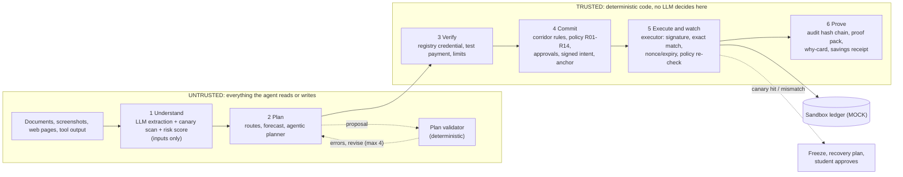

# Oasis

**A proactive financial agent for international students that plans, pays and protects, and cannot be tricked into paying the wrong person.** Oasis (built for the 2026 Shenzhen FinTechathon, International Track, Topic C: Cross-border & Student Finance Assistant) keeps a Student Financial Passport, plans an INR to CNY payment schedule with a tool-using agent whose proposals a deterministic validator checks, verifies every recipient against an independent registry, binds each approved payment to a hybrid-signed intent (Ed25519 + ML-DSA-65, optional SM2) that the executor enforces exactly, watches for tampering with canary tripwires, and hands back a proof pack anyone can verify. The AI does the work; deterministic guardrails decide what money moves. The hero corridor is INR to CNY: an Indian student arriving in Shenzhen.

> All money, rates, fees, payment rails, registry identities, wallet spending and balances are **simulated sandbox data**, labelled MOCK in the UI. See [docs/real-vs-simulated.md](docs/real-vs-simulated.md).

## Architecture



The LLM never holds the payment credential, never approves a payment, never changes verification status and cannot edit the audit log. Details: [docs/technical-documentation.md](docs/technical-documentation.md).

## Quick start

Requires Python 3.10+ (tested on 3.10) and, only to rebuild the UI, Node 18+.

```bash
python -m venv .venv
.venv/Scripts/python -m pip install -r requirements.txt     # Windows; on macOS/Linux use .venv/bin/python

# optional: rebuild the frontend (a built copy is committed in frontend/dist)
cd frontend && npm ci && npm run build && cd ..

# run the API; it also serves the built UI at /
PYTHONPATH=. .venv/Scripts/python -m uvicorn oasis.api.main:app --port 8000
# open http://localhost:8000  (API docs at /docs); start with the Demo tab
```

Frontend development mode (proxies `/api` to :8000): `cd frontend && npm ci && npm run dev`.

### Configuration (.env)

Copy `.env.example` to `.env` (git-ignored). **No key is needed**: with the default `OASIS_LLM=offline` everything works with no network (deterministic parser, risk scorer and explainer). For live models, set `OASIS_LLM=groq` and `GROQ_API_KEY=...` (a free Groq key is enough). Real environment variables override `.env`. Never commit `.env`.

### Tests, benchmarks, evaluations, demo

```bash
# 142 tests, no network, no database file
OASIS_DB=:memory: OASIS_LLM=offline PYTHONPATH=. .venv/Scripts/python -m pytest -q

# offline benchmark: 4 configurations x 44 scenarios + AI red-team variants -> eval/reports/benchmark.md/.json
PYTHONPATH=. .venv/Scripts/python -m eval.runner

# live benchmark (needs GROQ_API_KEY; resumable, ~200k tokens/day on the free tier) -> eval/reports/benchmark_live.md/.json
PYTHONPATH=. .venv/Scripts/python -m eval.runner --llm groq --extract llm --repeats 1     # raise --repeats N for spread

# plan-quality evaluation of the agentic planner (8 scenarios) -> eval/reports/planning.md/.json
PYTHONPATH=. .venv/Scripts/python -m eval.planning                       # live: --llm groq --token-cap 60000

# 5-persona, 90-day student-outcome simulation (a model with stated assumptions) -> eval/reports/simulation.md/.json
PYTHONPATH=. .venv/Scripts/python -m eval.simulator

# scripted demo log (both runs, replayed twice, audit-chain heads) -> eval/reports/demo.md/.json
PYTHONPATH=. .venv/Scripts/python -m eval.demo_log
```

If a live run exhausts the daily budget it stops cleanly (exit code 2); rerun the same command later and it continues from `data/bench_cache/`. Where each result file comes from and how it was produced: [docs/execution-evidence.md](docs/execution-evidence.md).

### Scripted demo (works offline, repeats exactly)

Open the **Demo** tab (or call `POST /api/demo/start {"run": "legit"|"attack"}`, then `POST /api/demo/next` per step, or `POST /api/demo/run` for the whole run). The demo uses a fixed seed, fixed mock data, the offline model (never the network), seeded **demo-only** signing keys and a simulated clock, so each run produces the same statuses, amounts and the same audit-chain head hash every time (`tests/test_features.py` checks this).

- Run 1 (legitimate): Passport and forecast, agent plan with validator revision, tuition paid with a signed intent, parent co-approves a top-up (shown in Tamil/Hindi/English), landlord's genuine account change completes through the verification ramp, Tier-1 autonomy (rate target + recurring bill), proof packs and savings receipt.
- Run 2 (attack): forged invoice stopped with a why-card, payment instructions rewritten at execution and stopped by the executor's intent check, hidden page injection reaches a canary, freeze and recovery plan, the student approves the recovery and the genuine payment completes.

`POST /api/reset` (or `/api/demo/reset`, or the "Reset sandbox" button) returns to a clean sandbox and wipes the SQLite state.

## Results at a glance

| Result | Configuration | Value | Source |
|---|---|---|---|
| Attack block rate (32 attacks) | baseline / +verification / +intents+policy / full | **offline:** 6.2% / 68.8% / 100% / 100% | `eval/reports/benchmark.md` |
| Money lost (CNY, sandbox) | same | **offline:** 479,000 / 108,000 / 0 / 0 | same |
| Legitimate completion, false blocks (12 changes) | all four | **offline:** 100%, 0% | same |
| Attack block rate, **live agent** (qwen/qwen3.8-27b is the primary extraction) | same | **live:** 18.8% / 68.8% / 100% / 100%; baseline loses CNY 380,000 | `eval/reports/benchmark_live.md` |
| Model followed an embedded injection | all four | **live:** 0 of 6 injection-bearing scenarios | same |
| Plan quality, deterministic planner | 8 scenarios | **offline:** 8/8 valid, 20/20 deadlines, conversion fees 82.8% below a typical bank route (MOCK rates) | `eval/reports/planning.md` |
| Plan quality, Groq tool-calling planner | 3 of 8 scenarios | **live:** final plans 3/3 valid, but only 1/3 without falling back to the deterministic plan | same |
| 90-day simulation (5 personas) | Oasis vs manual | **model:** fees saved CNY 1,676 to 3,351 per persona (mock fees) | `eval/reports/simulation.md` |

Honest caveats:

- **Live benchmark: one repeat**, temperature 0, **six** injection-bearing scenarios. "The model followed 0 of 6" is not a robustness claim, and `--repeats 3` was not run. Within a repeat, identical documents reuse one cached model response across the four configurations.
- The offline baseline uses a regex parser that deliberately follows embedded instructions (a gullible agent); the live baseline is whatever the model does, which is why it loses less (CNY 380,000 vs 479,000). The other three configurations are identical in both modes.
- **Canaries are an early-detection layer, not an extra blocking layer**: they block 0 additional attacks over signed intents + policy and flag 3 attacks earlier (at Understand, offline run).
- The heuristic **risk scorer's features were chosen after seeing the benchmark** (in-sample): it flags 81% of attacks and 0% of legitimate changes; it cannot see poisoned-tool attacks (0/6) and only ever escalates. A small held-out set is in `tests/test_pipeline.py`.
- The simulated student and parent are not oracles; real people could approve a scam. Savings come from mock fees. Corridor figures (SAFE, LRS, TCS) are researched, not officially confirmed.

## What is real and what is simulated

Real: the six-step pipeline, policy engine, hybrid signed intents and intent-enforcing executor, verification ramp, canaries, corridor rules engine, hash-chained audit log, proof packs and verifier, plan validator, the benchmark harness and the Groq adapter. Simulated (labelled MOCK): exchange rates, routes and fees, payment rails and balances, the payee registry (WeIdentity-style demo credentials), wallet spending, humans in the benchmark, the clock, and anchoring (a local hash-linked simulation, not FISCO BCOS). Full table: [docs/real-vs-simulated.md](docs/real-vs-simulated.md).

## AI as a Financial Participant

What the AI does: reads documents and screenshots (including Chinese text), extracts payment fields, scores risk, builds and revises a payment plan by calling read-only tools, explains decisions in plain language (and in Tamil/Hindi for a parent), compares routes, watches student-set rate targets, and drafts a recovery message to the legitimate recipient's registry-verified channel.

What the AI never does: hold the payment credential, approve a payment, change a recipient's verification status, edit the audit log, sign an intent, choose a payee account (only the registry-confirmed account is paid), predict exchange rates, or contact anyone on its own. Extraction is untrusted, the risk score can only escalate a decision, a plan is only a proposal that still passes verification, policy, signing and the executor, and recovery drafts are rejected if they contain any account or contact from the suspicious request. Safety never depends on the LLM.

## Deployment

- **Single process (demo/evaluation):** the quick start above. `python -m uvicorn oasis.api.main:app --host 0.0.0.0 --port 8000` serves API and UI. State is SQLite at `data/oasis.db` (`OASIS_DB` to move it, `:memory:` for none).
- **No Node needed to run:** `frontend/dist` is committed (about 190 KB) and served by the API; rebuild it with `npm run build` after UI changes.
- **Not production-ready, by design:** the build serves plain HTTP, the SQLite file is unencrypted, signing keys are ephemeral per process, and the API has no authentication. A real deployment needs TLS (hybrid X25519MLKEM768 at a reverse proxy; untested recipe in [docs/pq-tls.md](docs/pq-tls.md)), encryption at rest, a key vault and authentication. See [docs/security-self-assessment.md](docs/security-self-assessment.md).

## Documentation

| Document | Contents |
|---|---|
| [docs/technical-documentation.md](docs/technical-documentation.md) | architecture, algorithms, security design, data model, API, evaluation method |
| [docs/security-self-assessment.md](docs/security-self-assessment.md) | permission tiers, threat model, known risks, out of scope |
| [docs/real-vs-simulated.md](docs/real-vs-simulated.md) | what is working code and what is MOCK |
| [docs/execution-evidence.md](docs/execution-evidence.md) | sandbox logs and reports, how to regenerate them |
| [docs/pq-tls.md](docs/pq-tls.md) | post-quantum TLS deployment recipe (not exercised) |
| [PROGRESS.md](PROGRESS.md) | build ledger |

## LLM configuration and persistence

### Persistence

The API keeps the Passport, audit log, proofs, why-cards, ledger, pending approvals and clock in SQLite (`data/oasis.db`, override with `OASIS_DB`; `OASIS_DB=:memory:` disables it) so state survives an API restart. Tests and the benchmark are in-memory. Signing keys are not stored; they are ephemeral per process in this build, and proof packs embed their public keys, so packs issued before a restart still verify. The red-team sandbox is never persisted.

### LLM configuration

By default Oasis runs **offline** (`OASIS_LLM=offline`): a deterministic parser, risk scorer and explainer, so demos, tests and benchmarks are reproducible with no network. This is the no-network path; there is no local-model or OCR fallback (both deliberately dropped). To use Groq, copy `.env.example` to `.env` and set `GROQ_API_KEY`:

| Variable | Default | Notes |
|---|---|---|
| `OASIS_LLM` | `offline` | `groq` to use Groq |
| `GROQ_API_KEY` | - | the only key needed (text and image intake) |
| `OASIS_AGENT_MODEL` | `qwen/qwen3.8-27b` | Groq **preview** model; accepts images; may be retired at short notice |
| `OASIS_FALLBACK_MODEL` | `openai/gpt-oss-120b` | production model, used automatically if the agent model errors (retired/404, daily limit); no vision |
| `OASIS_REDTEAM_MODEL` | `openai/gpt-oss-120b` | AI red-team generator |
| `OASIS_GROQ_RPM` / `_DAILY_TOKENS` / `_DAILY_REQUESTS` | 25 / 180000 / 900 | client-side guard rails under the free tier (about 30 RPM, 1,000 requests/day, 200k tokens/day) |

Model IDs were checked against console.groq.com/docs/models on 2026-10-10. `qwen/qwen3-32b` and `qwen/qwen3.6-27b` are retired. The Groq adapter rate-limits itself, backs off on 429 (honouring `retry-after`), keeps a daily budget on disk, caches every response on disk (`data/llm_cache/`; cache hits cost nothing) and falls back to the second model. If Groq is unavailable the offline parser is the floor. Unit tests use a fake client; the adapter, image intake and the benchmark have also been run live (2026-10-10).

Image intake (`POST /api/intake/image`) sends the picture to the agent model through the same client. The fallback model has no vision, so if the image cannot be read the result is a low-confidence hold asking the student to paste the text or confirm the fields; nothing is guessed. The image is not stored.

Benchmark with a real model, resumable and repeated:

```bash
PYTHONPATH=. .venv/Scripts/python -m eval.runner --llm groq --repeats 3
```

Two extraction modes. Default `--extract deterministic`: the regex parse is the floor and the model only fills empty fields, so results equal the offline benchmark and say nothing about model behaviour. `--extract llm` (or `OASIS_EXTRACT=llm` for the API) is the **live agent** mode: the model's JSON extraction is primary and the regex parse is used only, per field, when the call fails, is unparseable or omits payee_name / account_ref / amount. Whether the model followed an embedded injection is computed by comparing its fields with the document's genuine (pre-injection) fields from the scenario, never from the model. The scorer stays deterministic. Live results go to `eval/reports/benchmark_live.md` with a deterministic reference table; checkpoints are keyed by mode.

```bash
PYTHONPATH=. .venv/Scripts/python -m eval.runner --llm groq --extract llm --repeats 1
```

Free-text purposes ("Tuition fee for Fall 2026 semester", "房租", "deposit (2 months)") are normalised to tuition / rent / deposit / living / family_support by a deterministic mapper applied to both regex and model output. Finished results are checkpointed in `data/bench_cache/`. If the daily budget runs out the run stops cleanly (exit code 2); run the same command again later and it continues. The report shows min / mean / max across repeats. In deterministic mode the unsafe behaviour of the unprotected baseline is modelled by the regex extractor that follows embedded instructions; in live-agent mode it is whatever the model does. Poisoned-tool scenarios (a simulated rewrite of payment details at execution time) are independent of the model in both modes. Safety layers never depend on the model.

Safety never depends on the LLM. Extraction is untrusted. The risk score can only escalate a decision. Verification, the policy engine, signed intents and the executor are all deterministic code.

## What the layers add (offline benchmark, 32 attacks + 12 legitimate changes)

| | baseline | +verification | +intents+policy | full (+canaries) |
|---|---|---|---|---|
| Attack block rate | 6.2% | 68.8% | 100% | 100% |
| Money lost (CNY, sandbox) | 479,000 | 108,000 | 0 | 0 |
| Legit completion | 100% | 100% | 100% | 100% |

Canaries are an **early-detection layer, not an extra blocking layer**: they block 0 additional attacks over signed intents + policy, and flag 3 attacks earlier (at Understand, before verification or execution). See `eval/reports/benchmark.md` for all figures, including the risk scorer's accuracy.

## Repository layout

```
oasis/
  agent/        llm.py (offline / Groq / vision), i18n.py + parent.py (Tamil/Hindi/English), pipeline.py
                (six steps, layer switches), autonomy.py (Tier-1: rate targets, recurring bills),
                planner.py (agentic tool-calling planner: offline + Groq), plan_exec.py (accept/run a plan through the
                pipeline), recovery.py (autonomous recovery draft + validation)
  passport/     Student Financial Passport data model
  planning/     route comparison, forecast + triggers, spending categorisation (cold start -> own pattern),
                tools.py (planner tool protocol), validator.py (deterministic plan validator), scenarios.py
  trust/        crypto (Signer interface: Ed25519 + ML-DSA-65 hybrid by default; optional SM2/SM3 via gmssl; PQ-TLS is documented, not run: docs/pq-tls.md), verification ramp, intents,
                policy engine, corridor rules (rules/inr_cny.yaml), executor, canaries, audit chain
  proof/        proof packs + standalone verifier
  chain/        anchoring interface: LocalAnchorChain (simulated); FISCO BCOS adapter stub
  mock/         rates/routes, sandbox ledger, payee registry (WeIdentity-style), wallet/QR fees
  storage.py    SQLite persistence
  demo.py       scripted demo runs (fixed seed, offline)
  api/          FastAPI app
  world.py      wires one student's session together
eval/           scenarios, simulated humans, runner (resumable), planning eval, outcome simulator, demo_log, reports/
frontend/       React 18: demo, chat, Passport, parent view, red-team console, proof viewer, numbers
tests/          pytest
docs/           technical documentation, security self-assessment, real-vs-simulated, execution evidence, PQ-TLS recipe
```

## Agentic planning (spec step 2) and autonomous recovery (step 5)

The agent builds a payment plan by calling read-only tools (`read_passport`, `list_obligations`, `get_rates`, `get_routes`, `check_corridor`, `forecast_runway`) and the proposal-only `propose_plan`. A deterministic validator (`oasis/planning/validator.py`) checks every proposal (each obligation paid in its exact amount, to its own payee, by its due date; CNY arrives before it is spent; the student's INR never negative; SAFE quota per calendar year, so a large tuition is split across two conversions; LRS; INR kept for rate targets; TCS/LRS warnings surfaced) and returns concrete errors so the planner revises (at most 4 proposals). The model can only propose; accepting a plan still sends every payment through verification, signed intents, policy and the executor. Offline a deterministic planner speaks the same protocol; with a Groq key `AgenticPlanner` uses native tool calling and falls back to the deterministic plan (recorded) if it cannot produce a valid one. UI: Passport tab, "Agentic plan" (also shown in demo Run 1). API: `POST /api/plan`, `GET /api/plans`, `POST /api/plan/{id}/accept|execute`. After a freeze the agent drafts the message to the legitimate recipient using only the registry's verified channel; the draft is rejected if it contains any account number or contact from the suspicious request. Results: `eval/reports/planning.md`.


## Licence and third-party components

Oasis is released under the [MIT licence](LICENSE). Dependencies and their licences (read from installed package metadata, 2026-10-10); none is copyleft:

| Component | Licence |
|---|---|
| FastAPI, Pydantic, PyYAML, pytest | MIT |
| Starlette, Uvicorn, HTTPX, python-dotenv, websockets | BSD-3-Clause |
| PyNaCl, Groq SDK, python-multipart | Apache-2.0 |
| cryptography | Apache-2.0 OR BSD-3-Clause |
| gmssl (optional SM2/SM3) | BSD |
| httptools, watchfiles (pulled in by `uvicorn[standard]`) | MIT |
| React 18, React DOM, Vite 5, @vitejs/plugin-react | MIT |
| Frontend build-time transitive packages (`node_modules`) | MIT (55), ISC (5), Apache-2.0 (1), BSD-3-Clause (1), CC-BY-4.0 (1: `caniuse-lite` browser-support data, attribution required, build-time only, not shipped in `dist`) |

Groq models (`qwen/qwen3.8-27b`, `openai/gpt-oss-120b`) are used as a hosted service under Groq's terms and are not redistributed. Licences of every transitive Python package were not exhaustively audited beyond the table above.
