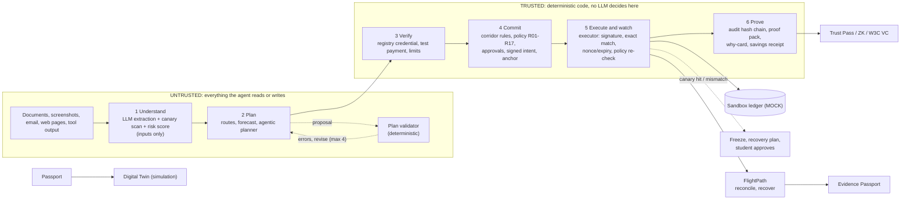

# Oasis: full overview (long form)

This is the complete former README (all features, all results, all 24 known limitations). The short README is [../README.md](../README.md).

**A student finance assistant for cross-border study: it plans the semester's payments, finds the route that delivers the most, warns before money runs short, and will not pay the wrong person.**

Built for the 2026 Shenzhen FinTechathon, International Track, **Topic C: Cross-border & Student Finance Assistant**. Hero corridor: an Indian student arriving in Shenzhen (INR to CNY).

Oasis keeps a Student Financial Passport and proposes a payment plan with an AI model; deterministic code checks, signs, enforces and records every payment. It then follows the payment after it is sent (FlightPath), simulates the semester's risks (Digital Twin), and turns verified payments into portable proof (Trust Pass, Evidence Passport).

> All money, fees, payment rails, registry identities and balances are **simulated sandbox data**, labelled MOCK in the UI. Exchange rates are **real** in the Docker image (`OASIS_RATES=live`: ECB reference rates fetched server-side, cached, with a labelled MOCK fallback); local runs and tests default to a mock snapshot so results repeat. See [docs/real-vs-simulated.md](real-vs-simulated.md).

## Contents

1. [The problem](#the-problem)
2. [How Oasis answers each pain](#how-oasis-answers-each-pain)
3. [Features](#features)
4. [A student story: Arjun](#a-student-story-arjun)
5. [What the AI does vs what code does](#what-the-ai-does-vs-what-code-does)
6. [Results at a glance](#results-at-a-glance)
7. [Quick start](#quick-start)
8. [Architecture](#architecture)
9. [Security, honesty and limitations](#security-honesty-and-limitations)
10. [Documentation index](#documentation)

## The problem

International students moving money across a border meet four recurring failures:

1. **Invoice-redirect fraud.** A forged invoice, or a "my bank account has changed" message from a fake landlord or finance office, sends tuition or rent to a criminal.
2. **Hidden fees.** The amount that leaves the sender is not the amount that arrives; spreads, wallet fees and card fees are buried.
3. **Payments that arrive short, late or twice.** A right payment to the right person still fails: delayed past a deadline, short-credited by intermediary deductions, or resent in panic and duplicated.
4. **No credit history.** Most students arrive with no credit file and none travels across the border, so landlords ask for large deposits or guarantors.

Cited external evidence (sources, dates and gaps: [docs/problem-evidence.md](problem-evidence.md); read 2026-10-11; **no user research with real students has been done**):

- Sending money costs about 6.5% of the amount on average worldwide and banks are the dearest provider type at about 14.6% ([World Bank Remittance Prices Worldwide, Q1 2025](https://remittanceprices.worldbank.org/sites/default/files/rpw_main_report_and_annex_q125_1_0.pdf), read via a summary); we found no cited India-to-China tuition figure.
- Paying in China by foreign card in WeChat Pay carries a 3% fee on each payment of CNY 200 or more ([Beijing government](https://english.beijing.gov.cn/travellinginbeijing/essentials/inboundtourismfacilitationmeasures/202603/t20260326_4566766.html)).
- Shanghai's government warns international students about texts from a "landlord with a new number" asking for rent to a different card ([Shanghai government](https://english.shanghai.gov.cn/en-Editor'sPick-StudyinShanghai/20240828/f7b950613be9462e80a8bd94ca2c38de.html)); a Belgian university warned that fraudsters alter the account number on genuine tuition invoices ([VRT News](https://www.vrt.be/vrtnws/en/2026/10/01/ku-leuven-warns-of-invoice-fraud-with-tuition-fee-payments/), date unresolved).
- The Ministry of External Affairs told the Rajya Sabha in 2023 that about 10,000 Indian students were in higher education in China, adding that students do not register with missions ([Careers360 report](https://news.careers360.com/no-specific-data-indian-students-studying-abroad-china-mbbs-russia-fmge-covid-in-spite-of-constant-efforts-ministry)).

## How Oasis answers each pain

| Pain | Feature | How | Proof (all sandbox) |
|---|---|---|---|
| Invoice-redirect fraud | Payee registry, signed intents, policy R01-R17, executor | The paid account comes from an independent registry, never the document; a changed account triggers re-verification; the executor enforces the signed intent exactly | 100% of 32 visible and 28 hidden attacks blocked, CNY 0 lost; forged tuition invoice alone: CNY 30,000 saved |
| Fraud a judge invents | Break-it challenge | Paste any attempt; it runs through the real pipeline and returns the rule and why-card | Live in the Break it tab; deterministic attacker generator with scoreboard |
| Hidden fees | Route comparison, wallet converter, planner | Ranks routes by what the recipient receives; shows wallet fee and saving versus a typical bank | Planning: fees CNY 4,990 vs 29,378 (83% lower); simulation: CNY 1,542 to 2,963 saved per student over 90 days (mock fees) |
| Missed deadlines, running short | Deterministic plan validator, forecast, Digital Twin | Plans checked for exact amounts, quotas, runway; Monte Carlo of FX, late top-ups and rail delays | 20 of 20 deadlines met across 8 planning scenarios; Twin gives per-deadline probabilities and mitigation uplift (simulation) |
| Arrives short, late or duplicated | FlightPath | Pre-transfer checks, recipient-amount routing, delay and short-credit detection, no blind resend | Simulated benchmark: 0 duplicate payments vs 62 baseline; 119 of 119 preventable issues flagged (own model, see caveats) |
| Cost of FX spread | Peer netting (simulation) | Matches INR-to-CNY payers with CNY-to-INR payers at mid-rate | Saving grows with pool size, 0 for a pool of one (synthetic cohorts) |
| No credit history | Trust Pass, ZK threshold proofs, W3C VC export | Student-held credential from verified payments; selective disclosure; any threshold provable without revealing counts | Tamper and false-claim tests pass; sandbox credential, not a credit score |
| Credit building is passive | Credit growth | A plan of milestones from verified payments only, evidence per ask (lower deposit, no guarantor, student card) with what is missing, and a what-if simulator over Oasis's own metrics; never suggests extra payments | Read-only, student-only, offline; not a credit score and no lender prediction |
| Fees are owed in USD or EUR, not CNY | Five more corridors, foreign-currency plans and payments | CNY-USD, INR-USD, EUR-USD, INR-EUR and CNY-EUR priced on the amount the recipient must receive, with sourced rule notes; a USD or EUR bill is planned, accepted, signed by the student and paid through the same trust path | Live Nova Pro: 25 of 27 plannable plans model-only valid, 3 of 3 above-LRS plans refused; route prices are estimates, not quotes |
| "Did this payment really arrive?" | Evidence Passport | One signed, QR-verifiable bundle: intent, registry payee, reconciliation, audit-chain proof | Login-free verifier with tamper tests; reconciliation is MOCK |

## Features

**Core protection**
- Six-step pipeline: Understand, Plan, Verify, Commit, Execute and watch, Prove.
- Independent payee registry (WeIdentity-style demo credentials), verification ramp (registry check, test payment, low limit, full limit).
- Policy engine R01-R17 (plus R18-R19 for foreign-currency payments), permission tiers, corridor rules from `oasis/trust/rules/inr_cny.yaml` (each value with source and status).
- Hybrid Ed25519 + ML-DSA-65 signed intents enforced exactly by the executor (nonce, expiry, policy re-check).
- Canary tripwires, freeze and recovery plan, SHA-256 hash-chained audit log, proof packs with an independent verifier, plain-language why-cards.
- Sanctions screening against snapshots of four public lists, US OFAC (17,515 entries), UN (1,010), UK OFSI (5,120) and EU (6,233): evidence for review, never an automatic block or a compliance clearance. Card and IFSC format checks.
- Optional trained fraud-risk model (`OASIS_ML_RISK=1`, escalate-only).
- Security headers and an optional passkey (WebAuthn) second factor.

**Planning and money**
- Student Financial Passport, spending categorisation, cold-start to own-pattern forecast, shortfall and runway warnings, SAFE quota and Indian TCS awareness.
- Agentic planner with a deterministic validator and fallback; deadline-aware tuition and rent plans.
- Route comparison, six-currency wallet view (INR, CNY, USD, EUR, GBP, AUD), in-app converter, 60-day coverage check.
- Tier-1 autonomy: rate-target conversions and recurring bills within small limits; savings receipt.

**FlightPath** (payment-journey reliability, [docs/flightpath.md](flightpath.md)): predict (pre-transfer checks), plan (routes ranked by recipient amount with a worst-case deduction margin), simulate (journey state machine), reconcile (delay and short-credit detection), recover (never resends while the first transfer is unresolved). FlightPath tab; journeys persist and verdicts go to the audit chain.

**Trust Pass, zero knowledge and W3C VC** ([docs/w3c-vc.md](w3c-vc.md)): student-held credential from payments that passed all checks; claims or thresholds only; salted commitments and selective disclosure; audience binding; zero-knowledge proof of any threshold ("at least 94% on time") with counts hidden; QR plus login-free verifier page; export as a W3C Verifiable Credential (`did:key` issuer, Ed25519 proof; only partly spec-conformant). The simpler signed payment-reliability record remains.

**More corridors** (`oasis/corridors/core.py`, data in `oasis/trust/rules/corridors.yaml`): CNY→USD, INR→USD, EUR→USD, INR→EUR and CNY→EUR next to the original INR→CNY. Read-only route comparison on the amount the recipient must receive (closed-form send amount, worst-case intermediary deduction, saving vs a typical bank) and per-payment rule findings, each with source and status. Route prices are public-range estimates (each flagged sourced, estimated or assumed, with its source), not live quotes. The India and China limits are read from `inr_cny.yaml`; the euro-area row and the new corridors' applicability are secondary-sourced or UNCONFIRMED, see [docs/corridor-research.md](corridor-research.md), which also explains how to replace MOCK route prices with real ones. **Foreign-currency plans and payments** (`oasis/planning/fxplan.py`, `oasis/agent/fx_exec.py`, `POST /api/plan/fx`, offline results in `eval/reports/fxplan.md`): for a bill owed in USD or EUR the planner (deterministic, or the live tool-calling model over a three-tool FX toolbox) proposes conversions and a payment over these corridors, and a validator recomputes every number (worst-case intermediary deduction, balances per currency, arrival dates, LRS and TCS for India, the SAFE quota for China, source-and-status rule notes). The student accepts the plan and it runs through the normal trust path: the payee account comes from the verified registry (never from a document), the student signs the exact payment with the registered device key, the executor checks the signed intent including the currency, the single-use tool token is bound to the currency, and the ledger refuses a transfer whose currency does not match both accounts. A parent-remitted INR conversion needs the parent's signed consent. A foreign-currency payment is never automatic and is not part of the Trust Pass (that stays CNY-only). In the UI, Passport tab, "Pay a bill in USD or EUR" adds a sandbox bill from one of two fixed MOCK universities. The INR→CNY planner ignores non-CNY bills and is unchanged. Cumulative use (India remittances, the China SAFE quota) is tracked across plans. The live model evaluation (`python -m eval.fxplan_live`, spends tokens, needs the owner's approval) was run on 2026-10-13 on Amazon Nova Pro: 30 plans (9 scenarios × 3 repeats, plus 3 extra repeats of the hardest scenario after it missed once; 233,701 tokens) covering all five new corridors. Of the 27 plans that should be plannable, the model's own plan was valid without the deterministic fallback in 25 and a valid plan was delivered in all 27; the 3 plans that should be refused (a payment above the India LRS limit) all correctly ended with no valid plan. Both misses are the INR→USD parent top-up scenario (4 of 6 model-only valid, the fallback delivered the rest). Per corridor, model-only valid: CNY→EUR 3/3, CNY→USD 3/3, EUR→USD 3/3, INR→EUR 3/3, INR→USD 10/12 (3 plans needed no conversion). Mock world, small sample, not a robustness claim (`../eval/reports/fxplan_live.md`).

**Credit growth** (`oasis/proof/credit_growth.py`): read-only, student-only guidance over the Trust Pass record. A milestone plan that separates verified payments from external ones it cannot count (and never suggests extra payments), per-ask evidence with what is missing, and a what-if simulator over Oasis's own metrics. It is not a credit score and does not predict any landlord, bank or lender; starter-product repayments made outside Oasis change nothing, by design.

**Evidence Passport** ([docs/evidence-passport.md](evidence-passport.md)): one signed bundle proving a payment went to a registry-verified payee and arrived, verifiable by anyone at `/?evidence=<code>`; verification needs the server, proof-pack and registry issuer keys to match pins.

**Financial Digital Twin** ([docs/digital-twin.md](digital-twin.md)): seeded Monte Carlo (600 paths by default, about 0.2 s) of the rest of the semester: per-deadline probability, p10/p50/p90 balance fan chart, and mitigations (convert now, pay earlier, faster route, sized parent top-up) measured by re-running the same random paths.

**Peer netting** ([docs/peer-netting.md](peer-netting.md)): MOCK simulation of matching opposite INR/CNY flows at mid-rate; only verified, approved payments with at least 2 days to deadline enter the pool. Netting tab.

**Break-it challenge** ([docs/breakit.md](breakit.md)): live fraud input plus a deterministic offline attacker generator (up to 12 variants) with a scoreboard.

**Intake channels** ([docs/real-inputs.md](real-inputs.md)): pasted text, photo or screenshot (including Chinese text), uploaded .eml, optional Telegram bot and IMAP mailbox watcher. Email headers (sender authentication, Reply-To mismatch, free-mail sender, hidden instructions) add risk evidence, never authority.

**Chat tasks** ([docs/agent-api.md](agent-api.md)): a deterministic English and Chinese intent router (`oasis/agent/nlu.py`, keywords and regexes, no model) turns "pay my rent", "what do I owe?", "cheapest route?", "cancel that" or "the amount should be 2600" into the existing guarded actions. A payment is built from the obligation and the registry's credential, never from an account in the text, and ends as a held draft that only the student's device-key signature releases. It asks one follow-up question when something is missing or ambiguous, explains an unregistered payee and offers the registered one, refuses requests for secrets or to bypass approval (audited as `chat_refused`, category only), and returns machine-readable fields (`intent`, `status`, `pending_id`, `draft_hash`, `needs`, `money_moved`, `proof_id`) for scripts. `tools/oasis_client.py` signs drafts the way the browser does. Reading a payment from a sentence (`oasis/agent/nl_extract.py`) fills only fields the labelled parse left empty. An opt-in model label for messages the router cannot place (`OASIS_CHAT_LLM=1`) exists but needs the user's own paid AWS Bedrock access (no key is shipped) and was tried live on Nova Pro: on held-out messages 18 of 20 unusual phrasings labelled correctly; 2 of 10 adversarial label-manipulation traps got a payment label until the validator was tightened (0 of 10 after, post hoc); a model-labelled payment can only be a whole open bill drafted for signature (`eval/reports/chat_llm_heldout.md`; our own messages).

**LLM options**: `OASIS_LLM=offline` (default; deterministic, no key, reproducible) or `bedrock` (Amazon Nova Pro on Amazon Bedrock, with a daily token cap and an optional lifetime budget, `OASIS_BEDROCK_TOTAL_TOKENS`; setup in [docs/bedrock-setup.md](bedrock-setup.md), which notes that the planner path was run live on Amazon Nova Pro on 2026-10-13, while vision was checked live on 2026-10-17 on 6 generated MOCK images (mixed: English and injection cases passed; Chinese text and a blurry image were misread, see [security-self-assessment.md](security-self-assessment.md)), and extraction and the LLM risk scorer were run live on it on 2026-10-17 (1 repeat, 44 scenarios; legitimate completion 83.3%, see [results.md](results.md) section 3)). The live planner evaluation in the results used Amazon Nova Pro on Bedrock (see Results).

**Languages**: English (default) and Simplified Chinese interface and server messages; parent approval in Tamil, Hindi, Chinese or English. All non-English text is machine-drafted ([docs/i18n-glossary.md](i18n-glossary.md)).

**Hosting and optional extras**: Docker image with live rates that refuses to start without explicitly set passcodes; FISCO BCOS 4-node local-chain anchoring (`OASIS_ANCHOR=fisco`); post-quantum TLS recipe (OpenSSL client only).

## A student story: Arjun

Arjun lands in Shenzhen with INR 5 lakh. He owes tuition, rent, a deposit and a family-funded top-up, about CNY 42,000 in total, each with a deadline. In the scripted demo (offline, repeats exactly) Oasis does this:

- **Sees the shortfall on day one.** He needs about INR 604,727 and is INR 104,727 short, with warnings about low runway, the SAFE annual quota and Indian TCS when a parent sends money.
- **Compares routes and saves fees.** The agent's plan (valid after 2 validator revisions) saves **CNY 1,653 vs a typical bank route**.
- **Meets deadlines**, with CNY arriving before it is spent.
- **Pays tuition with a signed intent** to the registry-verified university account and gets a proof pack he can show anyone.
- **Gets parent co-approval** in Tamil, Hindi, Chinese or English (templated text, not native-reviewed).
- **Handles the landlord's genuine account change** (paid in 45 simulated minutes, nothing wrongly blocked) while a forged invoice is stopped with a plain-language why-card.
- **Builds a payment reputation:** issues a Trust Pass naming the verifier (for example "Landlord, Room 1203"), shows a QR code, and the landlord's phone re-verifies every signature. It is credit building, not a credit score, and cannot be padded by paying a friend, because every payment went to a registry-verified payee.
- **Sends the invoice the way it arrives.** A forged test email (failed sender authentication, Reply-To on another domain, free-mail sender, hidden instruction text) scores risk 0.98 and is rejected at Verify; the genuine one scores 0 and waits for his signature.
- **Acts within small limits:** a rate-target conversion and a recurring bill, then a **savings receipt** (CNY 1,313.66 in the demo).

Try it in the Demo tab (Run 1 is this story, Run 2 is the attack story).

## What the AI does vs what code does

| The AI model (untrusted; proposes and explains) | Deterministic code (decides, enforces, proves) |
|---|---|
| Reads documents and screenshots (incl. Chinese text) and extracts payment fields | Validates every plan: exact amounts, payees, deadlines, quotas, runway |
| Proposes and revises a payment plan by calling read-only tools | Verifies the recipient against an independent registry; applies policy rules R01-R17 |
| Explains decisions in plain language, Tamil and Hindi | Signs intents (Ed25519 + ML-DSA-65), enforces them at execution, keeps the audit chain and proof packs |
| Optional extra risk score (can only escalate) | FlightPath, Digital Twin, netting, Trust Pass, ZK proofs, Evidence Passport, sanctions screening, the optional trained risk model (logistic regression, pure Python) |

**Plain statement:** most of the work is deterministic code, not the AI. Unaided model planning was evaluated live with Amazon Nova Pro: valid without fallback in **16 of 24** plans with planner v2 and **24 of 24** with planner v3 (calculator tools for route choice, consolidation, SAFE and parent splits; 23 of 24 on the first proposal; fees within 1% of the deterministic planner). Small sample (3 repeats of 8 scenarios, 2026-10-13), and the final plan is always checked by the deterministic validator with a deterministic fallback behind it. The code default is still v2; set `OASIS_PLANNER_FORMAT=v3` to use v3. The AI never holds credentials, approves a payment, changes a verification status or edits the audit log. The trained risk model ranks documents slightly better than the hand-set rules (AUC 0.80 vs 0.75) but flags no extra attack (13 vs 14 of 28), so it is reported as modest.

## Results at a glance

All sandbox data. Full tables and labels: [docs/results.md](results.md); raw files in `eval/reports/`.

| Result | Number | Caveat |
|---|---|---|
| Visible benchmark (32 attacks, offline) | 100% blocked, CNY 0 lost (unprotected baseline: 6.2%, CNY 479,000 lost) | Our own attacks; simulated humans, so partly by construction |
| Hidden blind set (28 attacks, offline) | 100% blocked (strict criteria; baseline 32.1% since the 2026-10-14 sentence-level extraction, 39.3% before) | Independent author, but partly burned: its failures were fixed afterwards |
| Blind set 2 (28 attacks + 12 legit, offline) | First run: 27 of 28 attacks blocked (96.4%), CNY 0 lost, 12 of 12 genuine completed. Re-scored after one criterion correction: 28 of 28 (baseline 39.3%; 32.1% after the 2026-10-14 sentence-level extraction, full configuration unchanged) | Second independent author who never read the implementation. The one first-run failure was a scoring gap, not a leak: rent split into four invoices, two instalments of CNY 2,900 (running total 5,800 of 6,000 owed) went to the genuine landlord, nothing to an attacker. The strict criteria now count a running total within one obligation as owed, for this set only; first run kept in [`benchmark_blind2_prefix.md`](../eval/reports/benchmark_blind2_prefix.md), re-score in [`benchmark_blind2.md`](../eval/reports/benchmark_blind2.md). Simulated humans; AI-written |
| Live model vs injections | Followed 0 of 18 embedded injections (2026-10-12); changed a field in 0 of 128 poisoned invoices and raised the risk on 0 of 40 genuine ones (2026-10-18) | Samples of one model, our own texts; intervals 0 to 3% and 0 to 9%; not a robustness claim |
| Planning (8 scenarios, deterministic) | 8/8 valid, 20/20 deadlines, fees CNY 4,990 vs 29,378 (83% lower) | MOCK fees and rates |
| Route savings (90-day simulation) | CNY 1,542 to 2,963 saved per student | Model with stated assumptions, mock fees |
| Live planner, model-only (Nova Pro, v2) | 16 of 24 plans valid without fallback (67%) | 8 fallbacks to the deterministic plan; 391,069 tokens |
| Live planner, model-only (Nova Pro, v3) | **24 of 24** valid without fallback; 23 of 24 on the first proposal | 3 repeats, 150,079 tokens; fees CNY 15,087 vs CNY 14,969 deterministic vs CNY 88,307 bank (83% lower); small sample | 
| Planner v3 vs v2 (Nova Pro) | v3 24 of 24 vs v2 16 of 24 | same scenarios, same cap and temperature; v3 adds calculator tools and fix hints; v2 stays the code default |
| Trained risk model vs rules (hidden) | AUC 0.804 vs 0.747; flagged 13/28 vs 14/28 | Synthetic training data; off by default |
| FlightPath (400 transfers, seed 11) | Duplicate payments 0 vs 62 baseline; preventable issues flagged 119/119 vs 0/119; false alarms 0.0; recipient-amount error 4.43 vs 4.9 CNY | SIMULATION on mock rails; the deduction model is our own, so this shows the mechanism, not accuracy on real rails |
| Peer netting (seed 11) | Saving vs routing alone: 0% for a pool of 1, 79% (2), 56% (10), 42% (50), 55% (200), 48% (1000); matched volume 22 to 44% | Synthetic cohorts; real pools are thinner and lopsided; needs a licensed counterparty |
| Digital Twin | Probabilities and mitigation uplift per seeded run (reproducible) | Assumptions stated, not measured (0.3% daily FX volatility, 35% late top-up); a student who lacks the money has near-zero probabilities and only a top-up helps |
| Fresh attack set (49 cases, offline) | First run: 32 of 33 attacks blocked, 12 of 16 genuine requests completed; after general fixes: 33 of 33 and 15 of 16; after sentence-level extraction (2026-10-14): 33 of 33 and 16 of 16 | AI-written with knowledge of the defences (fresh, not blind); the first run found an unhandled error and missing layouts |
| Risk scorers, out of sample (fresh set) | Rules AUC 0.81, trained model AUC 0.92; 16 of 30 attack documents flagged, 0 of 16 legitimate | Scorers only escalate; cross-validation inside the training corpus gives 1.00, so that corpus is easy |
| Foreign-currency planner, live (Nova Pro, 5 new corridors) | 25 of 27 plannable plans model-only valid, 27 of 27 delivered valid, 3 of 3 above-LRS plans refused; 233,701 tokens | Mock world, small sample; both misses are the INR-USD parent top-up scenario |
| Foreign-currency planner, offline | 8 of 9 scenarios valid, the 9th refused for the LRS limit | Route prices are public-range estimates, not quotes (`../eval/reports/fxplan.md`) |
| Chat task benchmark (92 scripted tasks, offline) | 92 of 92 end states correct; mean 1.08 user turns per completed payment; 10 tasks asked a follow-up (all correct); 0 false refusals; CNY 0 lost | Our own tasks, written by the same team, run against a keyword router on MOCK data; not an independent benchmark and nothing about a live model (`../eval/reports/tasks.md`) |
| Chat model labels (optional, live, Nova Pro, held-out 30 calls) | 18 of 20 unusual phrasings correct, 1 wrong, 1 dropped; 2 of 10 adversarial traps got a payment label as run, 0 of 10 after the post-hoc validator fix. Tuned set: 19 of 22 (in-sample); first prompt 12 of 22 | One model, our own messages; 9,106 + 7,822 + 4,688 tokens; needs the user's own Bedrock access (`../eval/reports/chat_llm_heldout.md`, `chat_llm.md`) |
| Tests | 1148 pass, 2 skipped (live FISCO, live PQ-TLS) | No network; the skipped two need local services |

## Quick start

Requires Python 3.10+ and, only to rebuild the UI, Node 18+. No API key is needed (default `OASIS_LLM=offline`).

```bash
python -m venv .venv
.venv/Scripts/python -m pip install -r requirements.txt     # Windows; on macOS/Linux use .venv/bin/python
PYTHONPATH=. .venv/Scripts/python -m uvicorn oasis.api.main:app --port 8000
# open http://localhost:8000 and log in (passcodes: see below); API docs at /docs
# optional UI rebuild: cd frontend && npm ci && npm run build   (a built copy is committed)
# tests (1607 passed, 2 skipped, no network):
OASIS_DB=:memory: OASIS_LLM=offline PYTHONPATH=. .venv/Scripts/python -m pytest -q
# simulation benchmarks (write eval/reports/flightpath.* and netting.*):
PYTHONPATH=. .venv/Scripts/python -m eval.flightpath_bench
# chat task benchmark (offline, forced; writes eval/reports/tasks.*) and the scripted client:
OASIS_LLM=offline PYTHONPATH=. .venv/Scripts/python -m eval.tasks_bench
PYTHONPATH=. .venv/Scripts/python tools/oasis_client.py --base http://127.0.0.1:8000 chat "pay my rent" --sign
PYTHONPATH=. .venv/Scripts/python -m eval.netting_bench
# extra corridors, foreign-currency planner, fresh attack set, out-of-sample risk scorers (offline, no model call; --live fetches free ECB rates):
OASIS_LLM=offline PYTHONPATH=. .venv/Scripts/python -m eval.corridors_bench [--live]
OASIS_LLM=offline PYTHONPATH=. .venv/Scripts/python -m eval.fxplan_bench
OASIS_LLM=offline PYTHONPATH=. .venv/Scripts/python -m eval.runner --llm offline --suite fresh --fresh-stem benchmark_fresh
OASIS_LLM=offline PYTHONPATH=. .venv/Scripts/python -m eval.risk_fresh
# refresh the UN / UK / EU sanctions snapshot (network): python tools/fetch_extra_sanctions.py
# live foreign-currency planner evaluation SPENDS TOKENS and needs the owner's approval: python -m eval.fxplan_live --cap N
```

**For a judge:** `scripts\start_judge.ps1` (Windows) or `bash scripts/start_judge.sh` starts everything offline with a fresh sandbox and prints the URL and logins; see [JUDGE_GUIDE.md](../JUDGE_GUIDE.md). Benchmark commands, LLM settings and env vars: [docs/configuration.md](configuration.md).

**Live model (optional):** follow [docs/bedrock-setup.md](bedrock-setup.md), then `OASIS_LLM=bedrock`. Keep offline for tests and any public instance.

**Hosting (Docker):** `docker compose up -d --build` runs a single-worker container that refuses to start without explicitly set passcodes and fetches live ECB rates server-side; see [docs/deployment-docker.md](deployment-docker.md) (statically checked and run from a clean venv, not yet built in Docker).

**Demo logins** (public, from `.env.example`; set `OASIS_PASS_*` for anything real):

| Role | Passcode | May do |
|---|---|---|
| student | `<student passcode>` | intake, chat, plans, rate targets, signed approvals, the scripted demo, reset |
| parent | `<parent passcode>` | signed approval of top-ups, sees only their own items |
| judge | `<judge passcode>` | read-only views, the rate-limited red-team console and the Break it tab |

Approvals are signed by browser-held Ed25519 device keys ([docs/technical-documentation.md](technical-documentation.md) section 11).

## Architecture



Code layout: `oasis/` (agent, api, chain, flightpath, intake, market, netting, passport, planning, proof, screening, trust, twin), `frontend/src/tabs/` (React UI), `eval/` (benchmarks and reports), `tests/`. Details: [docs/technical-documentation.md](technical-documentation.md) sections 4 and 12.

## Security, honesty and limitations

- The registry-confirmed account is the only one paid; each approved payment is bound to a signed intent the executor enforces exactly; canaries flag tampering; proof packs are verifiable by anyone.
- **Mock world:** fees, rails, registry and balances are simulated; nothing touches a real bank.
- **Benchmarks are partly by construction:** the same team wrote attacks and defences; humans are simulated. Two attack sets (hidden, blind set 2) were written by authors who never read the implementation, but both are AI-written and the humans in the loop are still scripted; none is a human red team.
- **Simulations are models:** FlightPath's deduction model is self-made, peer-netting cohorts are synthetic, and the Twin's parameters are stated assumptions. None is validated against real transfers, and none is a forecast or advice.
- **Live planner evidence is a small sample** (Nova Pro: v2 16 of 24, v3 24 of 24 valid without fallback; the five extra corridors 25 of 27); the validator and deterministic fallback stay in place.
- **Extra-corridor prices are estimates:** each route price is flagged sourced, estimated or assumed with its source; none is a live provider quote, and the euro-area and applicability rules are secondary-sourced or unconfirmed ([docs/corridor-research.md](corridor-research.md)).
- **The fresh attack set is not blind:** an AI assistant that had read parts of the defence code wrote it; its first run is kept unchanged next to the post-fix run ([eval/fresh/README.md](../eval/fresh/README.md)).
- **Demo-grade security setup:** shared passcodes, plaintext keys unless a passphrase is set; passkeys, the zero-knowledge proofs and email checks are not independently audited.
- **Credentials are sandbox credentials:** the Trust Pass and Evidence Passport are not credit scores or bank statements; the W3C VC export is only partly spec-conformant.
- **Real channels untested live, Bedrock partly:** Telegram and the mailbox watcher were tested against fake servers; on Bedrock, the planner path was run live on Amazon Nova Pro on 2026-10-13 (7 repeats, 56 of 56 plans valid by 2026-10-18), while vision was checked live on 2026-10-17 on 6 generated MOCK images (mixed: English and injection cases passed; Chinese text and a blurry image were misread, see [security-self-assessment.md](security-self-assessment.md)), and extraction and the LLM risk scorer were run live on it on 2026-10-17 (1 repeat, 44 scenarios; legitimate completion 83.3%, see [results.md](results.md) section 3).
- **Translations are machine-drafted;** regulatory figures are researched, not confirmed by a bank or counsel; not legal advice.

The full numbered list of 25 limitations follows the documentation index.

## Documentation

| Document | Contents |
|---|---|
| [docs/agent-api.md](agent-api.md) | how to test Oasis with scripts: login, chat fields, signing a draft, errors, five copy-paste tasks; static `openapi.json` |
| [docs/results.md](results.md) | all benchmark, planning, live and simulation tables with precise labels |
| [docs/configuration.md](configuration.md) | LLM configuration, environment variables, persistence, benchmark commands |
| [docs/bedrock-setup.md](bedrock-setup.md) | step-by-step Amazon Bedrock (Amazon Nova Pro) setup, IAM, spend cap |
| [docs/technical-documentation.md](technical-documentation.md) | architecture, algorithms, security design, API, repository layout, deployment |
| [docs/security-self-assessment.md](security-self-assessment.md) | permission tiers, threat model, known risks, out of scope |
| [docs/security-evidence-matrix.md](security-evidence-matrix.md) | each security claim mapped to code, test and limits (no audit or certification) |
| [docs/compliance-mapping.md](compliance-mapping.md) | design alignment with LRS/TCS, SAFE, PIPL, DPDP, AML-style monitoring; explicitly NOT compliance |
| [docs/flightpath.md](flightpath.md) | FlightPath checks, lifecycle, recovery, benchmark and its limits |
| [docs/digital-twin.md](digital-twin.md) | Monte Carlo twin, assumptions, mitigation uplift |
| [docs/evidence-passport.md](evidence-passport.md) | Payment Evidence Passport contents, endpoints, trust model |
| [docs/peer-netting.md](peer-netting.md) | peer netting simulation and honest limits |
| [docs/w3c-vc.md](w3c-vc.md) | W3C VC export of the Trust Pass: what is and is not conformant |
| [docs/breakit.md](breakit.md) | Break-it live challenge |
| [docs/real-inputs.md](real-inputs.md) | email, Telegram, mailbox intake: setup, safety, what was tested |
| [eval/fresh/README.md](../eval/fresh/README.md) | the fresh attack set: how it was written, what it found, how to rerun |
| [docs/problem-evidence.md](problem-evidence.md) | cited evidence for the student problem and its gaps |
| [docs/regulatory-sources.md](regulatory-sources.md) | where each INR→CNY corridor figure came from |
| [docs/corridor-research.md](corridor-research.md) | the five extra corridors: regulation research, route-price evidence and how to replace estimates with real quotes |
| [docs/real-vs-simulated.md](real-vs-simulated.md) | what is working code and what is MOCK |
| [docs/execution-evidence.md](execution-evidence.md) | sandbox logs and reports, how to regenerate them |
| [docs/planner-efficiency.md](planner-efficiency.md) | planner format experiments (v1, v2, v3) |
| [docs/live-rates.md](live-rates.md) | live ECB rate handling |
| [docs/i18n-glossary.md](i18n-glossary.md) | translation glossary (machine-drafted) |
| [docs/deployment-docker.md](deployment-docker.md) | Docker, compose, hosting checklist, backup and reset |
| [docs/pq-tls.md](pq-tls.md) / [docs/fisco-bcos.md](fisco-bcos.md) | post-quantum TLS; FISCO BCOS local-chain anchoring |
| [JUDGE_GUIDE.md](../JUDGE_GUIDE.md) | 5- and 15-minute paths for a judge, offline, one command |

## Known limitations

1. **Authentication is demo-grade, on purpose.** Roles use per-role passcodes (student, parent, judge): the judge has its own separate passcode. None is built in or in the repository. Someone running Oasis locally gets fresh random passcodes printed in their own terminal at each start, and a hosted copy uses passcodes the operator sets and sends to judges with the submission, so they are not public. There are no per-person accounts, because the sandbox has no user database, no password reset and no MFA service to hold real logins, and it protects only simulated money. For a hosted copy, set your own `OASIS_PASS_STUDENT` / `_PARENT` / `_JUDGE` and `OASIS_JUDGE_MODE=1` (which refuses the public defaults) and share them only with the people who should get in. Real use would need per-person accounts, a user store and MFA. Also, approver device keys are trust-on-first-use. An optional passkey (WebAuthn) second factor exists (`OASIS_REQUIRE_PASSKEY=1`, off by default; a role can enrol its first passkey with the passcode alone); it was tested with a software authenticator and a virtual one in Chrome, not a hardware key, and is not independently audited ([security self-assessment][sec]).
2. **Key files are plaintext unless `OASIS_KEY_PASSPHRASE` is set (the judge start scripts now set a random one and require it, so their sandbox keys are wrapped).** Otherwise the keys under `data/keys/` rely on OS permissions only. Set `OASIS_REQUIRE_KEY_PASSPHRASE=1` and the server refuses to read or write a plaintext key file, and `GET /api/trust/fingerprint` reports `keys_encrypted`; the strict mode is off by default so the one-command demo still starts ([hardening][sec-hard]).
3. **FISCO BCOS is a 4-node local test chain** (real FISCO BCOS 3.17.1, all nodes on one host), opt-in via `OASIS_ANCHOR=fisco`. It shows the integration, not decentralised trust, and Oasis does NOT claim the on-chain challenge bonus (that is Topic F; Oasis is Topic C) ([FISCO BCOS notes][fisco]).
4. **PQ-TLS was tested with an OpenSSL client and in a real browser (Chrome 155)**: OpenSSL 3.5.9 negotiated X25519MLKEM768 via Caddy, and Chrome 155 negotiated it against the Go reference server on 2026-10-17. The certificate is classical ([PQ-TLS evidence][pq]).
5. **Much of the world is mock data.** Route spreads and fees, wallet conversion fees, payment rails and the payee registry are mock; exchange rates are live in the Docker image (`OASIS_RATES=live`, cached, MOCK fallback) and mock by default locally. The scripted Demo tab always uses the mock rate so it repeats exactly ([real vs simulated][rvs]).
6. **There is no API to real banks, and WeIdentity is not integrated.** The registry is made of WeIdentity-style demo credentials, and nothing is ever sent to a real bank ([real vs simulated][rvs]).
7. **Amounts are floats, but sandbox balances now use exact fen arithmetic.** Ledger and wallet balances are added and subtracted in `Decimal` on whole fen (`oasis/mock/money.py`), so transfers cannot accumulate float drift (tested). Amounts inside signed intents and API bodies are still floats, and production would use `Decimal` end to end. The foreign-currency path takes its USD/INR from the live or snapshot conversion table; the original INR→CNY checks still use one hard-coded USD/INR of 88.0.
8. **Demo Run 2 catches the forged invoice at step 3 (Verify), earlier than the spec's step 5, which is the stronger outcome.** The step 5 intent-mismatch catch is the second item of the same run (the rewritten-payment-instructions attack) ([technical documentation][tech]).
9. **The humans in the benchmark are simulated, so 100% results are partly by construction.** The scripted student and parent approve only requests consistent with the Passport. The blind hidden set is partly burned by fixes made after it, the mega stress tests are white-box (written with access to the code), and the independent sets were written by other AI assistants from the pitch and API document only, not by human red teams.
10. **Live results are small samples.** Live model-only planning with Amazon Nova Pro was valid without fallback in 16 of 24 plans (v2) and 24 of 24 (v3; one 3-repeat sample), and the live injection test covered 18 runs (0 followed), so neither is a robustness claim; the final plan is always checked by the deterministic validator, with the deterministic plan as fallback ([all live numbers][results]). Planner v3 is opt-in (`OASIS_PLANNER_FORMAT=v3`); v2 stays the code default (docs/planner-efficiency.md). On Amazon Nova Pro (2026-10-17) the live extraction benchmark ran once (44 scenarios, 1 repeat: legitimate completion 83.3%, 0 of 6 injections followed), and vision was checked on 6 generated images (Chinese text and a blurry image were misread).
11. **The risk scorer is heuristic and was tuned on the benchmark itself (in-sample).** Out of sample, on the fresh set, the rules flagged 16 of 30 attack documents (0 of 16 legitimate) with AUC 0.81, and the trained model 16 of 30 with AUC 0.92 ([report](../eval/reports/risk_fresh.md)). The optional LLM scorer can only escalate, and neither scorer can see poisoned tool output, which only intent binding stops.
12. **Regulatory figures are researched, several from secondary sources, and not confirmed by a bank or counsel.** Re-checked on 2026-10-13: the LRS limit and the Form A2 requirement are on the RBI Master Direction (primary); overseas tuition may be bought outside China's USD 50,000 SAFE quota with ID and the admission notice (SAFE Tianjin bureau, 2025-07-14); the India TCS rate for education is 2% in the Finance Act 2026 per search summaries, while the Income Tax Department's own rate page still showed 5%, so it stays unconfirmed. Confirm each figure with an authorised dealer bank, as this is not legal advice ([regulatory sources][regsrc], [corridor research](corridor-research.md)).
13. **Duplicate-check gap.** Duplicates of invoices older than 30 days are caught only through the paid-obligation check. An amount written in scientific notation (`1e5`) is no longer read as `1`: it is treated as unreadable and the student is asked to confirm.
14. **Tamil, Hindi and Chinese (zh-CN) text is machine-drafted: the parent approval wording and the Chinese interface and server messages have not been reviewed by native speakers.** English is the default and the competition's official language; see `docs/i18n-glossary.md`.
15. **Demo keys are public and seeded.** While a demo world is active the server pins their fingerprint, so a pack forged with the public demo seeds would verify during the demo (`GET /api/trust/fingerprint` reports `demo_keys: true`).
16. **The payment-reliability record is a sandbox statement, not a credit product.** It is signed by this server's key over simulated payments and simulated dates, is not a credit score, and no credit bureau, bank or regulator accepts it. The due date comes from the invoice the student supplied and is not inside the proof pack, so only the server's signature vouches for it. Only payments that went through the full pipeline with a verified proof pack are listed. The same holds for the **Trust Pass**: it is a server-signed sandbox credential, not a credit score; no lender is obliged to accept it; the preset threshold claims are attested by the server, while the optional zero-knowledge threshold proofs (any threshold, counts hidden) are a from-the-textbook construction that is not independently audited and still trust the server for the committed counts; the QR code locates a copy stored on this server, so an independent verifier should also take the JSON file and check the signature against the pinned key; and the payee level shown is the registry level at issue time ([technical documentation][tech], sections 15 and 18).
17. **The original corridor is INR to CNY; five more exist with weaker evidence.** INR→CNY has the full pipeline, researched rules and a 24/24 live planner evaluation. CNY→USD, INR→USD, EUR→USD, INR→EUR and CNY→EUR have route comparison, per-payment rule findings, foreign-currency plans and sandbox payments (a USD or EUR bill to a MOCK university, signed by the student), but their route prices are public-range estimates (not quotes), the euro-area and applicability rules are secondary-sourced or unconfirmed, foreign payments are not part of the Trust Pass. The live planner evaluation on them (30 plans, Nova Pro, mock world) was 25 of 27 model-only valid. Cumulative China outbound use (SAFE quota) and India remittances are tracked across plans and re-checked when a conversion runs; route prices older than 30 days are flagged stale. See [docs/corridor-research.md](corridor-research.md).
18. **Sanctions screening is a snapshot of four public lists.** US OFAC SDN (17,515 entries, retrieved 2026-10-12) plus the UN (1,010), UK OFSI (5,120) and EU (6,233) consolidated lists (retrieved 2026-10-13), with fuzzy matching on Latin-script names; a hit is evidence for review and a clean result is not a compliance clearance, common names give false matches (for example 'Zhang Wei'), the card and IFSC checks are format checks only, and the lists are not a live feed ([sanctions](real-inputs.md)).
19. **The real inbound channels were not tested live.** The email upload was tested in Chrome; the Telegram bot and the IMAP watcher only against fake servers (no bot token or mailbox was available), Telegram is blocked in mainland China without a VPN, and an uploaded email can carry any Authentication-Results header ([real inputs][inputs]).
20. **The trained risk model is modest.** On the hidden set it ranks documents slightly better than the rules (AUC 0.80 against 0.75) and on the fresh set better still (0.92 against 0.81), but it flags no extra attack at the 0.5 threshold, its synthetic training data was written by the same team as the rules (cross-validation inside it gives AUC 1.00, which shows the corpus is easy, not that the model generalises), and it is off unless `OASIS_ML_RISK=1` ([results][results], [fresh set](../eval/reports/risk_fresh.md)).
21. **Deployed on one small Azure VM, not load-tested.** The Docker image runs on an Azure virtual machine (Korea Central, 2 vCPU, under 1 GB of memory) behind Caddy with a Let's Encrypt certificate on a fixed Azure DNS name, with the live model (Amazon Nova Pro) on the authors' key and a lifetime budget of 3,000,000 tokens. It was checked on 2026-10-18 (health, login, chat, injection refusal, security headers, HTTP redirect). It has not been load-tested, tried from inside China or put behind a second host. A single worker serialises requests.
22. **Chat is keyword-based and the chat tasks are our own.** The intent router recognises the phrasings in `tests/test_chat_nlu.py` (English and Chinese) and answers anything else with a help message; it is not a language model and will miss paraphrases a model would catch. The 51 scripted tasks in `eval/tasks/tasks.json` were written by the team that built it. Chinese chat replies are machine-drafted. Student logins share one sandbox world (only the dialogue state is per login), so one automated grader at a time should `POST /api/reset` between tasks.
23. **Image reading is unreliable on hard inputs.** Checked live on Amazon Nova Pro with 6 generated MOCK images (2026-10-17): a clean invoice, a skewed photo and an injection image were handled correctly (the injected instructions were not followed), but a Chinese-language invoice had its payee and purpose misread and a blurry image produced invented values. Chinese reading has not been reviewed by a native speaker. Output of the vision step is a proposal only: a garbled reading is held, the student confirms the fields, and money goes only to the registry account.

[sec]: docs/security-self-assessment.md
[sec-hard]: docs/security-self-assessment.md#hardening-added-2026-10-10
[fisco]: docs/fisco-bcos.md
[pq]: eval/reports/pqtls.md
[rvs]: docs/real-vs-simulated.md
[tech]: docs/technical-documentation.md
[hidden]: eval/reports/benchmark_hidden_prefix.md
[plan]: eval/reports/planning.md
[regsrc]: docs/regulatory-sources.md
[inputs]: docs/real-inputs.md
[results]: docs/results.md

## Licence and third-party components

Oasis is released under the [MIT licence](../LICENSE). Dependencies (read from installed package metadata, 2026-10-10); none is copyleft:

| Component | Licence |
|---|---|
| FastAPI, Pydantic, PyYAML, pytest, React 18, React DOM, Vite 5, @vitejs/plugin-react, httptools, watchfiles, qrcode-generator | MIT |
| Starlette, Uvicorn, HTTPX, python-dotenv, websockets | BSD-3-Clause |
| PyNaCl, boto3, python-multipart | Apache-2.0 |
| cryptography | Apache-2.0 OR BSD-3-Clause |
| gmssl (optional SM2/SM3) | BSD |
| py_webauthn (passkeys), pypdf (optional, PDF text) | BSD-3-Clause |
| cbor2 (via py_webauthn) | MIT |
| Frontend build-time transitive packages (`node_modules`) | MIT (55), ISC (5), Apache-2.0 (1), BSD-3-Clause (1), CC-BY-4.0 (1: `caniuse-lite` browser-support data, attribution required, build-time only, not shipped in `dist`) |

Amazon Nova Pro on Amazon Bedrock is used as a hosted service under AWS terms and are not redistributed. Licences of every transitive Python package were not exhaustively audited.
